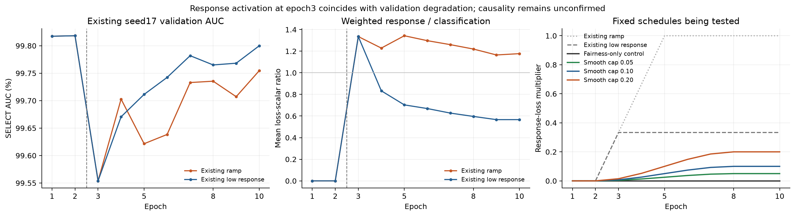

# Seed17 response ramp/strength tuning: four runs training

Observed management UTC: 2026-11-10T18:39:10.793141+00:00 (11 November 2026 IST). Source is the clean detached [execution commit d6c5c2f](https://github.com/hardikbha/CFES-BeatDing/commit/d6c5c2fe49da87d14af2b4cdfc336ac784163fe9). The earlier 21-run comparison and its seed 17 tables remain unchanged. This is a new TRAIN/SELECT-only screen; it has no TEST/CAL evaluation stage and trains no new Ding model.

## What the existing curves show

At epoch 3, existing ramp/low response losses first become active at multiplier 1/3. Seed17 SELECT AUC falls from 99.8182% to 99.5539%; the weighted response scalar averages 0.06015 versus classification 0.04504 (ratio 1.34). Low-response later recovers to 99.7999% at epoch 10 but still selects epoch 2. These are observed scalar/validation trajectories; they do not establish harmful gradient dominance or the cause of generalization failure. "Low" names a lower response weight, not an explicit variance penalty.

[Standalone PDF](SCHEDULE_DIAGNOSIS.pdf) · [exact parent SELECT curves](PARENT_SELECT_CURVES.csv).

## Fixed experiment, one varied ceiling

Every new candidate uses two response-free epochs and a six-epoch smoothstep ramp, reaching its ceiling at epoch 8. For zero-based epoch e≥2, t=min(1,(e−1)/6), response multiplier=ceiling×t²(3−2t). The fairness objective stays active at its unchanged strength 0.1 throughout.

| Candidate | Ceiling | First active multiplier (epoch 3) | Plateau sensitivity/alignment weights | Current allocation |
|---|---:|---:|---:|---|
| fairness-only control | 0 | 0 | 0 | gpu01 GPU6 |
| smooth_005 | 0.05 | 0.003704 | 0.005 each | gpu02 GPU7 |
| smooth_010 | 0.10 | 0.007407 | 0.010 each | gpu01 GPU4 |
| smooth_020 | 0.20 | 0.014815 | 0.020 each | gpu02 GPU4 |

The effective sham coefficient is half the sensitivity coefficient. Existing periodic auxiliary compensation remains 4. Compared with the old schedules, both ramp shape/duration and ceiling change; among these four new arms only ceiling differs. [Exact 10 epoch schedules](FIXED_SCHEDULES.csv), [bound configurations](configs), [four-run difference proof](MATRIX_VERIFIED.json).

Keep seed 17, all 218,266 TRAIN originals once/epoch, 31,107 SELECT images, ten epochs / 6,821 updates each, batch 32, the same P50 encoder and freshly initialized linear head, exit-stage adaptation/frozen BatchNorm, AdamW encoder 1e−5 / head 1e−3 / weight decay 1e−4, clip 5 and unweighted BCE. No LR, sampler, mask, input/probe or fairness-objective change is added. The common joint gender×race auxiliary policy and identical original/sham/treated forward exposure remain. These are controlled adaptations, not the historic five-axis/weighted-BCE L_H recipe or native-paper reproductions.

The original unused GDA diagnostic is retained as part of the inherited shared forward/objective implementation; no new Ding model/checkpoint is trained or evaluated. The new tuning entry point exposes only dry/train, with TEST/CAL paths removed from the four configs.

## Checks actually passed and current state

- **21 CPU tests PASS:**9 new schedule/objective/lifecycle/resume tests,9 inherited tests,3 queue/lease concurrency tests.
- **Fresh full 249,373 TRAIN/SELECT images hashed/decoded**, exact inventory parity with the frozen teacher input population, no cross-split byte overlap.
- The original 88-case PS-v2 recipe panel is reused with original decisions and explicit source/byte provenance. The operator, strengths and assets are unchanged; no new human or per-training-image approval is claimed.
- **All four real-input CUDA checks PASS:**same initial named parameters (`791cfa4aa904fa6382506e92b71bf60220fcadf37d29d6078e18ecd15c661716`), same actual input tensors, 20,809,001 total / 6,790,433 trainable parameters, frozen BN.
- Each candidate additionally passed one discarded active-coefficient update. Initial-model response/classification gradient-norm ratios at the plateau coefficients were 0/0.03467/0.06934/0.13868. These are dry-run initial-model measurements, not gradients measured from epoch 8of production training.
- **All four workers and training process groups were observed alive**, with first-epoch optimizer progress in their logs. [Node observations](LIVE_gpu01.json), [second node](LIVE_gpu02.json), [launch/check verification](READINESS_AND_LAUNCH_VERIFICATION.json).

[CPU logs and hashes](CPU_CHECKS.json), [new tests](https://github.com/hardikbha/CFES-BeatDing/blob/d6c5c2fe49da87d14af2b4cdfc336ac784163fe9/tests/test_tuning.py), [actual CUDA receipts](CUDA_checks), [fresh audit](FRESH_INPUT_AUDIT.json), [source-file hashes](SOURCE_CHECKOUT.json), [status snapshot](STATUS.md).

## Budget, selection and allowed conclusion

Four bounded sessions reserve at most 17 aggregate GPU-hours from 23.1128 recorded uncommitted hours in the original 48-hour ledger; no additional grant or ledger transfer. All historical sessions are byte-for-byte preserved. Actual held-card time, including loading/checks/failures, is charged. Native training cap 4 h and held-card cap 4.25 h each, with safety margin and only owned-child cleanup; no unrelated job is stopped. [Reservation](BUDGET_RESERVATION.json), [current ledger observation](BUDGET_CURRENT_SNAPSHOT.json).

The earliest maximum SELECT AUC across all ten epochs remains the primary selector. A selected pre-response epoch stays visible and cannot demonstrate response-learning benefit. Final/best post-activation behavior may be reported separately, never substituted for the primary checkpoint. Existing absolute utility screens remain AUC ≥99.5% and FNR ≤0.5651%. A useful point result needs a selected post-activation checkpoint and lower joint 100F_FPR than the new fairness-only control; retain AUC/FNR changes and every other-axis regression.

After all four complete native selected-checkpoint replay, a finite CPU-only comparison uses their stored SELECT predictions with 2000 paired connected-contributor bootstrap draws. Intervals need ≥95% valid replicates or are suppressed as INCONCLUSIVE. They condition on selected checkpoints and frozen thresholds, not unseen-data confirmation or training-seed uncertainty. Earlier TEST exposure and retrospective seed choice remain limitations. No TEST-based tuning or automatic TEST scoring is authorized.

No new performance result or win over Ding is available yet. There are no automatic retries, extra candidates, new seeds or next-stage extensions. The finite local monitor refreshes existing queue/history summaries every 60 seconds for at most 6 hours; it publishes no unattended GitHub updates and launches no training. [Monitor receipt](STATUS_MONITOR.json). This GitHub page is a dated snapshot.
