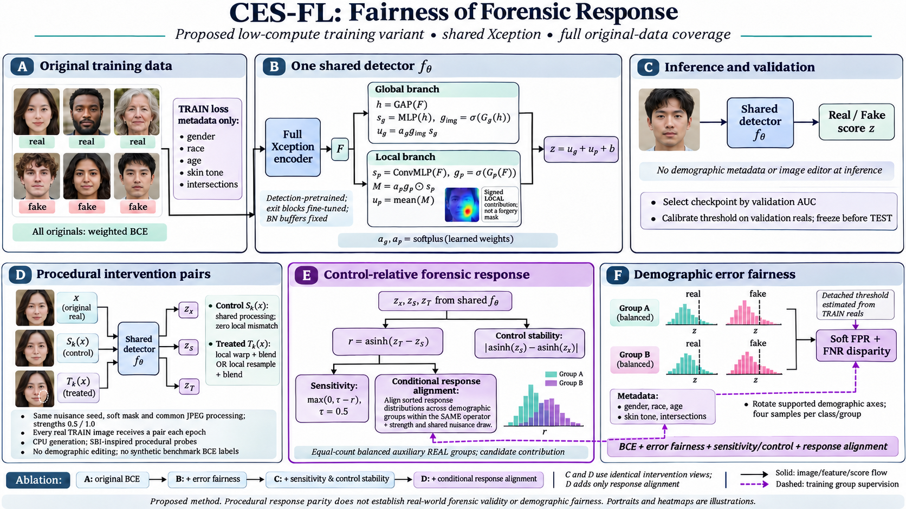

# CES-FL forensic-response experiment — 3 November 2026

The single-file implementation is [`../../src/ces_fl_forensic_response.py`](../../src/ces_fl_forensic_response.py). It implements input verification, procedural intervention previews, recorded operator qualification, four training arms, checkpoint/resume, evaluation, paired uncertainty estimates and contribution-map export. No other project Python module is imported. Python 3.10+, PyTorch, NumPy, Pillow and scikit-learn are required. A local, explicitly identified detection-pretraining checkpoint is required; models and packages are never downloaded automatically.

**Readiness:** all 10 independent unit tests and the full CPU software smoke suite pass. The receipt in `evidence/SMOKE_RESULT_CPU.json` binds the exact source hash. Real cluster inputs, H100 execution, operator qualification and scientific performance remain **unverified**. No cluster training or TEST evaluation was launched for this request. Synthetic fixture scores are software checks, not research results.

This is a new experiment, separate from the historical demographic-invariance and matched-quartet proposals. It does not complete their missing Qwen/manipulation banks. Historical configurations, results and preregistrations are unchanged.

## Hypothesis and controlled comparisons

Hypothesis: matching the distribution of a detector's response to a defined local intervention, relative to its processing control, across supported demographic groups may improve detection fairness beyond error-rate regularization and procedural sensitivity alone.

| Arm | Original weighted BCE | Soft error disparity | Sensitivity + processing-control stability | Conditional response alignment |
|---|---|---|---|---|
| A | yes | — | — | — |
| B | yes | yes | — | — |
| C | yes | yes | yes | — |
| D | yes | yes | yes | yes |

**D−C is the primary contribution ablation.** C−B tests the sensitivity/control package; B−A tests the error-fairness package. A/B versus C/D differ in forward-pass cost; B also has additional auxiliary forwards relative to A. These are objective/exposure ablations, not equal-FLOP comparisons. C and D have identical original order, auxiliary samples, operators, strengths and nuisance draws. All arms use identical fresh heads, encoder initialization, optimizer settings, planned epochs, BN policy and selection/calibration rules within a dataset.

The study remains seed17 with ten downstream epochs. For this new request, the primary fairness endpoint is `gender_race.F_FPR` at the common validation-calibrated FPR10% rule. Report all requested axes, FNR gaps, worst-group AUC, overall AUC and achieved FPR alongside it; do not declare success by selecting a favorable metric after evaluation. A tentative validation progression criterion is lower primary F_FPR in D than C, with at most 0.005 absolute AUC loss and no corresponding collapse in worst-group AUC. This criterion guides whether another dated confirmation request is worth funding; it is not a test-data selection rule or proof of superiority. Checkpoint selection itself remains highest validation AUC, with the earliest tied epoch retained.

## Exact implementation

`Detector` embeds the existing Xception architecture and the global/patch CES-FL head. The whole encoder is present. Default fine-tuning updates only the exit blocks and the heads; **all BatchNorm running buffers remain fixed**. The default model has **21,594,159 total parameters and 7,575,591 trainable parameters**. This differs from the older fully frozen CES-FL configuration with 787,207 trainable parameters.

For spatial features F and pooled features h:

```text
s_g = global_MLP(h)                    s_p = shared_1x1_patch_MLP(F)
g_img = sigmoid(image_gate(h))         g_p = sigmoid(patch_gate(F))
a_g, a_p = softplus(fusion_parameters)
M = a_p * g_p * s_p
z = a_g * g_img * s_g + mean(M) + b
```

Gates are learned weights. M is the signed **local contribution**, not a validated forgery mask; the global term and bias are separate. Demographic annotations are used for training losses and evaluation, never as detector inputs. Inference requires one original image and one detector forward pass.

All original real and fake rows receive BCE, with fixed inverse-frequency label×`ids8` weights normalized over TRAIN. Every original appears exactly once per epoch; the trainer checks this. Auxiliary resampling is additional and separately counted. For C/D, **every real TRAIN row also gets one processing-control/treated pair each epoch**. Fake originals retain ordinary BCE and can enter the auxiliary error-fairness loss; the code does not pretend it can remove their original manipulation evidence.

Two CPU operators rotate with strengths 0.5 and 1.0: local translation/warp followed by soft-mask blending, and local resampling mismatch followed by blending. A shared JPEG transform precedes both branches. The control uses identity sampling and zero local mismatch. The treated branch adds the defined local discrepancy inside an elliptical face-region mask. Generation is deterministic from source, epoch and seed. There is no Qwen, face-identity model, landmark detector or online GPU editor. Aligned face crops are an input assumption.

For a real original x, sham S and treatment T:

```text
r = asinh(z_T - z_S)
L_sens = mean relu(0.5 - r)
L_control = mean |asinh(z_S) - asinh(z_x)|
```

Control stability discourages satisfying the margin by pushing only the processing-control score down. It does not mathematically guarantee that all shortcuts are excluded. Synthetic views receive these response losses; **no benchmark real/fake labels are fabricated for them**. Shared JPEG, mask geometry and interpolation support reduce obvious processing confounds but cannot prove identical perceptual intervention difficulty across groups.

Every four original minibatches, the auxiliary sampler rotates a requested axis, takes four real and four fake examples per supported group, and uses one shared operator/strength/nuisance draw for the real samples. At least two groups per requested axis must have ≥20 originals of each class. Unsupported/unknown groups do not receive an auxiliary group loss, but all their originals still receive BCE. Missing support causes preflight to stop; it is not silently treated as full demographic coverage.

Error disparity uses soft FPR and FNR at a **detached TRAIN-real threshold**, estimated from a fixed natural TRAIN-real subset (up to 2,048 rows) each epoch. The pooled reference uses TRAIN class-conditional group proportions, while group deviations are averaged equally. This is a differentiable surrogate, not Ding's hard-threshold F_FPR.

Response alignment sorts the real responses in each auxiliary group, compares their quantiles with the group-mean quantile vector, and averages absolute deviations. Equal group sample counts and a common operator/strength stratum are enforced. The default four responses per group make this a noisy small-sample distribution estimate. It compares different people in observed demographic groups, not same-person demographic counterfactuals.

```text
L = weighted_BCE
  + 0.1 * (original_sensitivity + 0.5 * original_control)
  + I_aux * 4 * [0.1 * error_disparity
               + 0.1 * (aux_sensitivity + 0.5 * aux_control)
               + 0.1 * response_alignment]
```

Unavailable arm terms are zero. The factor four compensates for evaluating the auxiliary objective every four steps. Both original and balanced-auxiliary sensitivity are intentional: the first gives real-source coverage; the second gives balanced group exposure. The mask is used for construction and diagnostics only; no mask or map-consistency supervision is enabled.

## Dataset and protocol dependencies

`ffpp_template.json` and `ff2_template.json` contain exact manifest/checkpoint paths and hashes from archived evidence. Availability and byte agreement must be checked on the cluster before binding. Their `source_sha256` is intentionally null until the explicit `bind` command verifies files and imports encoder weights.

| Template | Encoder initialization already recorded in the repository | New downstream request |
|---|---|---|
| FF++ | Original-data P50, from `manip_response_ssh_20261101T115720Z/P/best.pt` | fresh A/B/C/D heads; 10 epochs each |
| FairForge-2 | Original-data P10, from `ff2_originals_s17_20261102_r1/training/best.pt` | fresh A/B/C/D heads; 10 epochs each |

Only encoder tensors are imported. The initialization checkpoint must name the same TRAIN/VAL sources and pass strict shape/hash checks. This file does not rerun or recreate those historical pretraining stages. A standalone source file still needs those external data and weights. If they are absent or incompatible, stop and record the dependency; do not substitute an ImageNet model silently.

Defaults: seed17; 224×224 bilinear input resize; Xception normalization; head/gate widths 128/64; batch32; four loader workers; AdamW head LR 0.001, exit-block LR 0.00001, weight decay 0.0001; gradient clipping5; CUDA bf16 training and float32 evaluation. Requested training axes are gender, race, age_bin, skin_bin and gender_race; `ids8` is additionally reported and used for original weighting. Annotation quality is inherited from the manifests and is not certified by this implementation.

Preflight hashes and decodes all TRAIN/VAL originals, checks manifest and initialization hashes, rejects undeclared content leakage, and reports group support. Known contributor overlap is accepted only through exact, hash-bound historical exceptions. Recorded contributor identifiers are not verified biological identities. The loader checks image bytes against preflight on access. No TEST input is required by any preparation/training command.

The CPU `preview` command creates private, stratified original/control/treated/difference sheets spanning each requested supported group and all operator/strength combinations. A named reviewer must inspect them, record each substantive flag and notes, then run `qualify`. This is representative **operator qualification**, not per-image approval of the full stochastic intervention space or proof of real-forgery validity. C/D refuse to train without a matching receipt. This gate implements the repository's requirement that sensitivity interventions be validated within their stated scope. Any rejected recipe needs a new dated proposal and fresh checks, not manufactured approvals.

## Evaluation and uncertainty

`train` selects the earliest highest validation-AUC checkpoint, calibrates a conservative empirical validation-real FPR≤0.1 threshold, reloads that checkpoint independently, and reproduces its validation report before writing `DONE`. The empirical budget handles tied scores; it does not guarantee TEST FPR. Each run has a provenance receipt, per-epoch coverage/loss/validation history, best and resumable last checkpoints, and execution-attempt records.

`evaluate` is separate and requires an exact TEST-manifest hash. Fit membership includes **TRAIN plus VAL**. Contributor/content overlap exceptions use `identity_ids:fit:test`, `source_ids:fit:test` and `declared_content_overlap_sha256`; they must be audited before looking at scores. No split is rewritten. Reports include frozen-threshold and fixed0.5 overall/group AUC, FPR/FNR, gaps, F_FPR, F_DP, es_AUC, worst-group AUC, and fake-family AUC against all reals, with fractions and group supports explicit.

Connected recorded identity/source/image components are resampled for 95% percentile bootstrap intervals. Eligibility is fixed before resampling, missing-class replicates are counted, and paired model comparisons share the same draws. These intervals measure dataset-sampling variability conditional on one trained model, **not training-seed variability**. Inaccurate identifiers or a giant connected component limit inference. Report this diagnostic rather than interpreting a degenerate interval as certainty. Row-level score files and intervention sheets remain private.

These new A–D runs are **not** an apple-to-apple reproduction of Ding Tables1–3: architecture/head, trainable capacity, pretraining budgets, training objectives and schedule differ. A defensible comparison still needs exact dataset rows, compression/preprocessing, backbone, seeds/budgets, selection, group definitions and threshold rules to be reconciled, plus separately labeled archived and fairness-gradient-corrected Ding variants. Never compare a new validation score directly with a paper test score. FairForge-2 is an additional benchmark, not automatically a Ding-paper table.

## Compute and launch

Follow [`GPU_OPERATOR_PROMPT.txt`](GPU_OPERATOR_PROMPT.txt). Use one allocated H100 per process; two H100s can run independent arms. There is no DDP requirement. Initial planning allowance is 24 total GPU-hours, not 24 hours per GPU. Reusing the recorded encoder checkpoints avoids another pretraining run.

The two-hour per-arm default is an **epoch-boundary execution allowance**, not a throughput promise or a hard scheduler limit. The first epoch and slow I/O can exceed the estimate; use the scheduler's actual limit. The one-step dry run measures GPU memory/backward feasibility, not full-epoch throughput. Budget against first completed epoch including validation and disk I/O. Reserve time for checks and reporting; eight two-hour arm allowances would consume16 GPU-hours if actually completed within them. Treat this as allocation arithmetic, not an ETA.

An incomplete run is explicitly marked incomplete and must not be compared as a matched ten-epoch run. Resume from `last.pt` with identical source/config and an explicitly logged larger **cumulative** `--budget-hours`, if within the agreed project budget. For example, `--resume --budget-hours 3` allows three cumulative hours for that arm, not three additional hours. Preserve epochs and selection policy. Do not silently reduce dataset coverage or train D longer than its controls. The user allows a modest budget extension if evidence supports it; log actual consumption and a concrete estimate before spending beyond the initial24 GPU-hours.

Prioritize real-input checks and the C/D comparison on FF++, then complete A/B, then the same four arms on FairForge-2. Publish all completed/incomplete arms and costs, including negative outcomes. A promising pilot justifies separate repeated-seed, leave-one-operator-out and held-out real-manipulation experiments. It does not justify an immediate 'beat Ding' claim.

## Novelty and limitations

The candidate contribution is **conditional alignment of control-relative forensic responses**, with a sensitivity margin and original detection/error controls. Neither Xception, global/patch gating, synthetic blending, group reweighting nor fairness alignment alone is claimed as novel. [SBI (CVPR2022)](https://openaccess.thecvf.com/content/CVPR2022/html/Shiohara_Detecting_Deepfakes_With_Self-Blended_Images_CVPR_2022_paper.html) already uses self-blended training images. [DAID](https://arxiv.org/abs/2507.02645) already combines demographic rebalancing and alignment for fair/generalizable detection. [Ding et al.](https://arxiv.org/abs/2511.10150) is the comparison target. This is not an exhaustive novelty review or a numerical novelty rating.

Main risks: synthetic-operator shortcuts; imperfect face alignment; nominal versus perceptual strength mismatch; noisy group annotations; sparse age/skin groups; quantile noise; original class/group weighting changing calibration; fairness gains accompanied by utility loss; and insufficient independent seeds. Procedural response parity need not imply parity on actual deepfakes. The current code makes that hypothesis testable at low generation cost; experimental outcomes remain unknown.

## Evidence and source map

`evidence/SMOKE_RESULT_CPU.json` records source hash, production parameter counts and checks. `evidence/unit_tests.log` records 10 passed independent tests. `evidence/smoke_cpu.log` contains synthetic end-to-end output only. No fixture images, weights, datasets or private score records are published.

| Component | Functions in the standalone source |
|---|---|
| Encoder/head and transfer | `Detector`, `load_initial` |
| Original coverage and operators | `Originals`, `intervention`, `auxiliary` |
| Fairness/response objectives | `soft_error_disparity`, `response`, `sensitivity`, `response_alignment`, `train_step` |
| Input integrity and qualification | `check_config`, `preflight`, `preview`, `qualify` |
| Training and recovery | `train`, `dry_run`, `build_optimizer`, `finite_step` |
| Reporting and uncertainty | `metric_report`, `components`, `bootstrap`, `evaluate`, `compare` |
| Contribution outputs | `export` |



The generated architecture figure is explanatory artwork; equations and functions above are authoritative. Portraits/heatmaps in it are generated illustrations, not dataset samples or measured model outputs.
