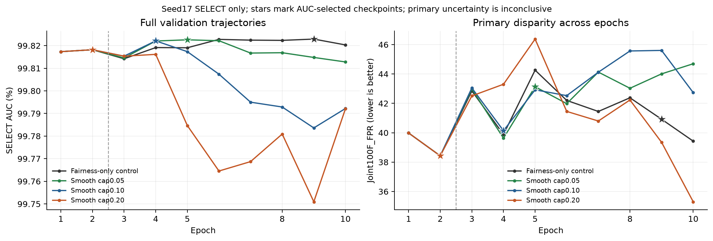

# Response-strength screen complete: SELECT/validation only

Observed management UTC: 2026-11-11T05:20:38.738978+00:00. **All four seed 17 runs completed ten epochs and native selected-checkpoint replay. Zero failed or active GPU runs remain in this screen.** All three paired SELECT comparisons completed. No TEST/CAL evaluation or new Ding model was run.

The 0.10 ceiling is the only active-response candidate meeting the declared point screen: it selects epoch 4, after response activation, preserves the absolute utility guards and lowers primary joint disparity against the fairness-only control. **Its 0.779 point improvement is inconclusive statistically**, and several other demographic gaps worsen. This is a small exploratory result, not a validated fairness advantage or win over Ding.

| Candidate | Selected epoch | Response multiplier at selection | SELECT AUC % | SELECT FPR % | SELECT FNR % | Joint100F_FPR ↓ |
|---|---:|---:|---:|---:|---:|---:|
| fair_only | 9 | 0.000000 | 99.8229 | 9.9672 | 0.2790 | 40.9199 |
| smooth_005 | 5 | 0.025000 | 99.8226 | 9.9672 | 0.2965 | 43.1332 |
| smooth_010 | 4 | 0.025926 | 99.8221 | 9.9672 | 0.2930 | 40.1410 |
| smooth_020 | 2 | 0.000000 | 99.8182 | 9.9672 | 0.2965 | 38.4295 |

AUC/FPR/FNR are percentages; joint 100F_FPR is summed absolute group-FPR deviation from pooled FPR. Each checkpoint is calibrated on the same SELECT-real population at an empirical 10% FPR budget; pooled FPR equality is by construction and does not establish held-out calibration.

- **Smooth 0.10:**joint 40.1410 versus 40.9199, difference −0.7789 points (about 1.90% relative). AUC changes by −0.000794 percentage points; FNR increases by 0.01395 points. Its selected response coefficient is 0.025926; the schedule ceiling 0.10 would be reached at epoch 8, but the selected model is from epoch 4.
- **Smooth 0.05:**selected epoch 5 with response active, but primary disparity is 2.2133 points worse than control. It does not meet the point screen.
- **Smooth 0.20:**lowest displayed primary disparity, but selects epoch 2 before response activation. Its row cannot establish response-learning benefit and fails the declared activation criterion.

[Standalone plot PDF](VALIDATION_TRAJECTORIES.pdf), [all 40 epoch summaries](ALL_EPOCHS_SELECT.csv), [selected metrics across all six axes](SELECTED_ALL_AXES.csv), [selected primary rows](SELECTED_VALIDATION_RESULTS.csv).

## Other-axis regressions for smooth0.10

| Axis | Fairness-only 100F_FPR | Smooth 0.10 | Difference (lower better) |
|---|---:|---:|---:|
| gender | 3.9370 | 4.1065 | +0.1695 |
| race | 19.6348 | 19.2595 | -0.3753 |
| gender_race | 40.9199 | 40.1410 | -0.7789 |
| age_bin | 9.8790 | 10.4782 | +0.5992 |
| skin_bin | 13.0348 | 13.3750 | +0.3402 |
| ids8 | 39.9177 | 40.9630 | +1.0453 |

Race/joint disparity improves in point estimates; gender, age, skin and IDS8 worsen. The selected result must retain these tradeoffs. Age/skin are automatic estimates, and source composition can confound demographic differences.

## Uncertainty and limits

All three primary joint comparisons have only **964 valid bootstrap replicates out of 2000** (48.2%), below the prespecified 95% minimum (1900). Conditional intervals are therefore suppressed as **INCONCLUSIVE**. The contributor audit contains 45 connected metadata components, largest 2,787 rows; these are not verified independent persons. Do not relax the threshold or substitute image-level resampling after observing the failure.

The saved intervals use identical paired connected-contributor draws and frozen selected thresholds. They condition on model/checkpoint selection and do not include selection uncertainty, independent confirmation or training-seed variability. This is one retrospectively chosen downstream seed sharing a pretrained encoder, after historical benchmark TEST exposure. The paired result summaries and any other usable intervals retain their exact scopes. [Comparison summary](COMPARISON_SUMMARY.json), [0.10paired native aggregate](smooth_010_minus_fair_only.json).

## Execution and verification

Source: [d6c5c2f](https://github.com/hardikbha/CFES-BeatDing/commit/d6c5c2fe49da87d14af2b4cdfc336ac784163fe9). The [fixed protocol and launch checks](../../proposals/ff2_response_tuning_20261110_r1/README.md) remain unchanged: two response-free epochs, six-epoch smoothstep ramps capped 0/0.05/0.10/0.20, same P50/fresh head, original input exposure, optimizer, hierarchy and relative response-loss weights. Only ceiling differs among new candidates. The earlier 21-run TEST tables are preserved.

All four actual checkpoint binaries were freshly SHA256-rehashed against their native replay/frozen receipts during publication. The 40 epoch chronology, max-AUC selection, active coefficients, full original coverage and comparison point estimates are checked without model execution or private prediction access during packaging. The first two epoch validation reports are identical across all candidates, consistent with their common response-free phase. [Native aggregate/config/CUDA/replay receipts](native), [verification](VERIFICATION.json), [artifact hashes](SHA256.json).

Actual held-GPU use was **11.2780hours**, within the 17-hour cohort reservation and original 48-hour allowance. All four ledger sessions are completed, their reservations are closed, and their GPU leases were verified released. No new budget, ledger transfer, other-job termination or automatic next candidate was introduced. [Final accounting](FINAL_GPU_ACCOUNTING.json), [gpu01 release](FINAL_RELEASE_gpu01.json), [gpu02 release](FINAL_RELEASE_gpu02.json).

No new TEST score, paired significance claim, confirmed fairness advantage or superiority over Ding follows from this screen. Smooth 0.10 is a candidate for further separately authorized study. Existing source/results remain intact; no extension is launched by this report.
